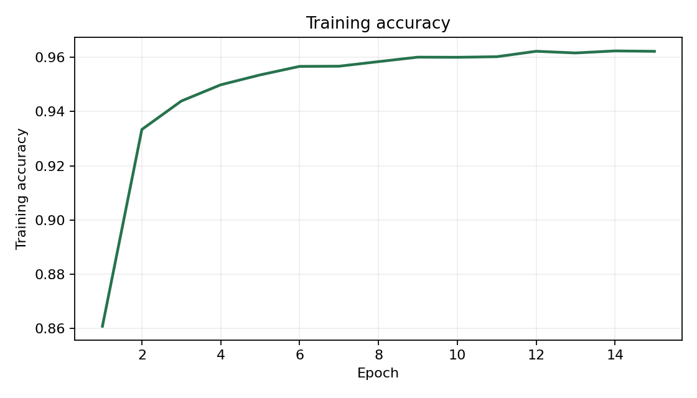
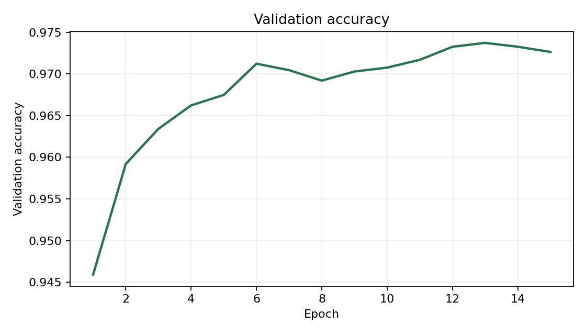
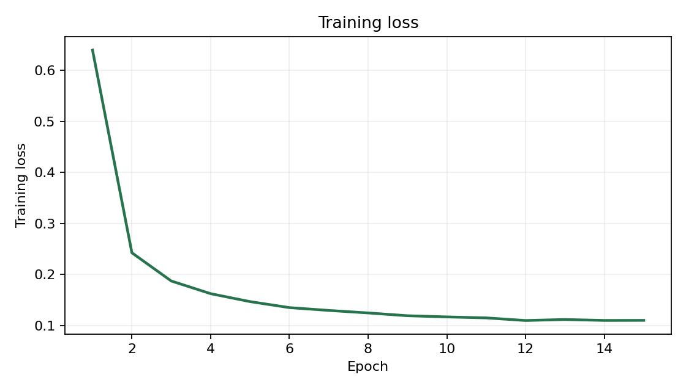
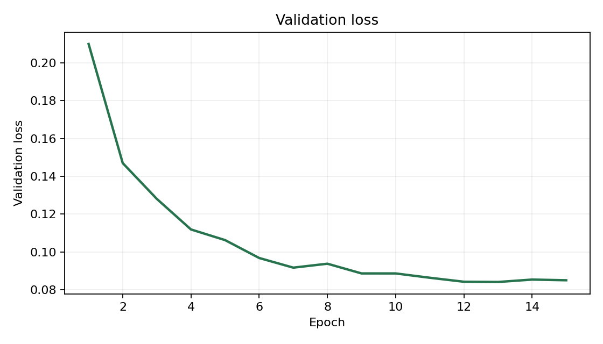
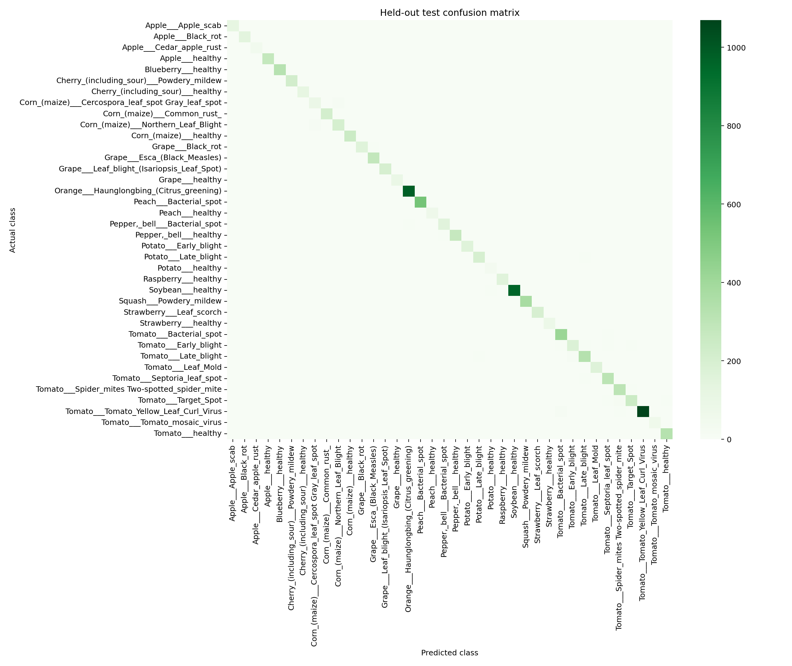
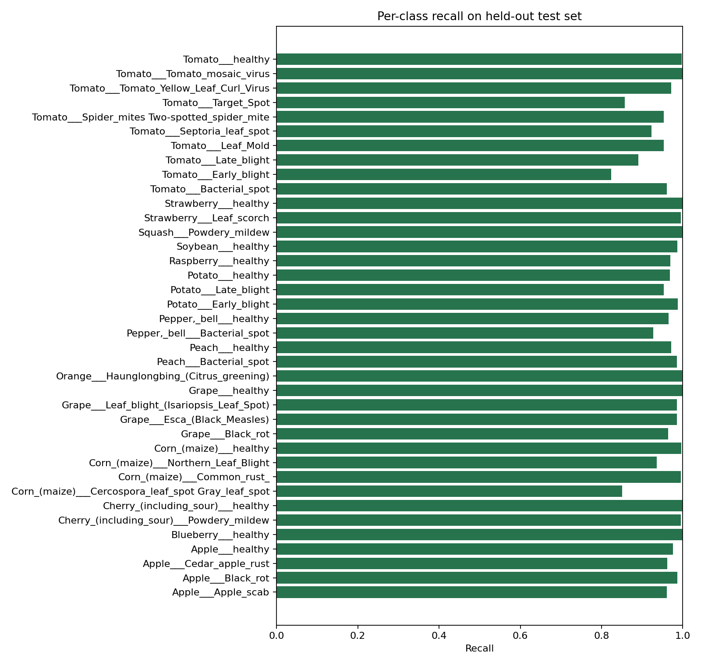

# Multi-Plant Leaf Disease Detection Using Deep Learning

## Abstract

LeafGuard AI integrates two real TensorFlow classifiers with a reproducible
PlantVillage pipeline and a Streamlit application. The experiment uses
53,447 audited color images across 14 crops and 38 categories.
A custom CNN pipeline trains from scratch; transfer learning uses an ImageNet-pretrained,
frozen EfficientNetB0 backbone and a trained classification head. Completed
experiments are reported below; unavailable baseline results are marked explicitly. Validation
loss selects checkpoints; separate calibration groups and real negative images
support empirical rejection checks. All results below come from saved artifacts.
Incomplete source leaf identities prevent a claim of complete physical-leaf
separation. Scores describe this controlled-image experiment, not field diagnosis.

## 1. Introduction and problem statement

Leaf symptoms can guide inspection, but multiple diseases, pests and
environmental stresses look similar. The objective is to classify the defined
PlantVillage categories, compare feature learning with transfer learning, expose
real predictions and clearly communicate uncertain assessments. Worldwide plant
identification, latent infection, disease severity and laboratory confirmation
are outside scope.

## 2. Literature overview

Mohanty et al. (2016) studied plant-disease recognition using deep learning on
controlled leaf imagery. EfficientNet (Tan and Le, 2019) scales convolutional
networks efficiently and provides reusable ImageNet representations. Temperature
scaling (Guo et al., 2017) adjusts probability calibration without changing class
rankings. Grad-CAM (Selvaraju et al., 2017) uses gradients for class influence
visualization. These methods support the system without establishing causal
diagnosis or universal recognition of unknown images.

## 3. Dataset description and source limitations

The source is `mohanty/PlantVillage`, color variant, commit
`9e97599868962bd0079b8db4b7f1efa9185fa1e7`, licensed CC BY-SA 3.0.
The archive SHA-256 is `fba30c6a7965e49be94b47a62f8aff6cfb1c35c27f475f22092b56db41745e84`.
There are 54,305 source color records, all of which were decoded and audited.
858 conflicting observations were excluded, retaining every
category. See `data/processed/summary.csv` for complete category counts.

Authentic legacy aliases recovered 2,025 metadata matches. The published map
still lacks verified physical-leaf IDs for 11,790 source records; 11,500
retained records use explicitly unverified source-image identities. The approved
publisher policy preserves source assignments and audits available leaf IDs,
exact decoded RGB hashes and conservative near-duplicates. Recovered metadata
exposed 213 cross-source-split physical-leaf groups. Matching lower-priority
observations were excluded while test observations stayed held out. Mixed labels
were quarantined. No test image was moved into training.

Near-duplicate checks require pHash distance <=2 and 32x32 RGB mean absolute
difference <=3; 2 pairs met this conservative rule.
Different views of a leaf can escape these checks. **Complete physical-leaf
independence cannot be verified**, and the results inherit this limitation.

| Partition | Images |
|---|---:|
| train | 29,941 |
| validation | 6,397 |
| calibration | 6,400 |
| test | 10,709 |

Validation and calibration each take 15% of source-training groups per category;
fractions apply to groups, not images. The test partition follows the publisher.
Manifest SHA-256: `4f9c62b3a8c38e594e067aa748e0976ca0205eba29c7e554206f9ed2605c107c`.

## 4. Methodology

Images are validated, EXIF-oriented, composited over white if transparent,
converted to RGB and bilinearly resized to 224 x 224 using the same Pillow
function in training and inference. Inputs are float32 pixels in [0,255]. CNN
rescaling and Keras EfficientNet preprocessing are embedded in their graphs.
Flips, small rotations, zoom and contrast apply only to training observations.
Adam minimizes sparse categorical cross-entropy with balanced training-class
weights. Validation loss controls checkpoints, early stopping and rate reduction.
The test partition never selects checkpoints, prototypes or rejection thresholds.

## 5. System architecture

The versioned archive and metadata enter a decoding/grouping audit, which writes
a fingerprinted four-way manifest. Training consumes training groups and selects
checkpoints using validation groups. Calibration consumes only reserved
calibration groups and independent negative collections; prototypes use training
embeddings. Evaluation consumes the frozen checkpoint and held-out test rows.
The app loads complete model bundles and saved evaluation artifacts without raw
images or retraining. Modules separate data, networks, inference, calibration,
evaluation, Grad-CAM and Streamlit presentation.

## 6. Model implementation

**Compact CNN:** 16-channel stride-2 convolution, 32/64-channel separable
convolutions, batch normalization, ReLU, max pooling and 0.15 dropout; a
96-channel 1x1 convolution; global average pooling; 0.4 dropout; a 38-way softmax.
This independently trained baseline contains 13,798 parameters. The optional
larger standard variant was not used for this experiment.

**EfficientNetB0:** official ImageNet weights, frozen backbone, global average
pooling, 0.4 dropout and a trained 38-way softmax head. Fine-tuning was not used
in the CPU experiment. Optional deeper-layer fine-tuning remains implemented.
Frozen forward passes use OpenVINO float32, with numerical comparison against
TensorFlow required before extraction. The head trains with TensorFlow/Keras,
and its weights are exported into the original complete native Keras model.
Original embeddings can be cached for all rows; augmented views exist only for
training rows. Test labels do not fit any parameter. Evaluation records whether
cached frozen embeddings or a full TensorFlow pass were used. Local app inference
always uses the complete TensorFlow model. Cache agreement on real test samples
and Grad-CAM checks are recorded in `reports/integration.json`.

## 7. Experimental setup

The local machine has an Intel Core i5-12450H and approximately 16 GB RAM.
Native Windows TensorFlow uses CPU; the NVIDIA laptop GPU was not used.
Python 3.13.7, TensorFlow 2.21.0, Keras 3.15.1, seed 42, batch size 32,
initial learning rate 0.001 and a maximum of 15 head epochs were used.
OpenVINO 2025.4.1 accelerates fixed EfficientNet features; two feature views
(original plus one training-only augmented view) train the head.

| Model | Head epochs completed | Fine-tune epochs | Confidence cutoff | Cosine-distance cutoff |
|---|---:|---:|---:|---:|
| efficientnet | 15 | 0 | 0.3500 | 0.369049 |

Exact run settings and dataset provenance are in each `training_config.json`.
Completed CNN epochs record elapsed seconds in history. The initial EfficientNet
run did not record an internal duration timer. Windows execution and Ubuntu
installation/regression checks in GitHub Actions passed; macOS and a Colab
runtime were not executed here.

## 8. Evaluation protocol and results

The table reports each completed validation-selected checkpoint on the same test
manifest. Precision, recall and macro F1 weight each class equally; weighted F1
weights by test support. These are closed-set scores before rejection.

| Model | Accuracy | Macro precision | Macro recall | Macro F1 | Weighted F1 |
|---|---:|---:|---:|---:|---:|
| efficientnet | 96.78% | 95.74% | 96.40% | 96.04% | 96.78% |

The main EfficientNet experiment is complete. CNN training and its comparison remain in progress; no baseline scores have been invented.

Completed evaluations have all six individual figures in their folders.
Machine-readable classification reports, per-class support and full confusion
matrices are in `reports/metrics/`. Checkpoint SHA-256 values:

* efficientnet: `847d17ffe4296129d78e8b00dce4d71ef3d2ce3e09dfb0c7a8ed4a57147a274a`.

## 9. Calibration and rejection audit

Reserved calibration groups are split into temperature-fit, threshold-tune and
audit partitions. Normalized class prototypes use training embeddings only.
Acceptance requires both temperature-scaled confidence and cosine proximity.
Tuning maximizes coverage subject to accepted accuracy >=90% and negative
acceptance <=5% for each negative category. Final audit requires >=100 ID and
>=100 negative images, >=30 accepted ID images and the same empirical criteria.
Each negative category requires >=30 audit examples. A failed audit keeps all
app assessments uncertain; it is not bypassed to make a demonstration appear
successful. The UI slider can only make a validated rule stricter.

Real negatives come from UCI Leaf (DOI 10.24432/C53C78, CC BY 4.0; Silva and
Maral) and CIFAR-10 (Krizhevsky). RGB-only specimens exclude supported genera;
unsupported species are disjoint between tuning and audit. CIFAR source train
images supply tuning objects and source test images supply audit objects.
Conservative exact/near-duplicate auditing covers both collections. Tuning has
208 leaves + 250 objects; audit has 223 leaves + 250 objects. Public sources lack
capture-session IDs: session independence cannot be verified. These controlled
collections do not represent every unknown field plant or object.

| Model | Audit passed | ID coverage | Accepted ID accuracy | OOD acceptance | Temperature |
|---|---|---:|---:|---:|---:|
| efficientnet | True | 97.48% | 96.78% | 0.00% | 0.7487 |

* efficientnet: ID audit n=2100, accepted=2047; ECE 0.00821 before and 0.01224 after scaling; unrelated_objects: 0/250 negatives accepted; unsupported_leaves: 0/223 negatives accepted.

See each `calibration.json` for sources, fit/tune/audit counts, thresholds,
hashes and limitations. No audit-informed threshold changes are permitted
without a fresh audit collection.

## 10. Discussion and limitations

Transfer learning uses visual features learned outside PlantVillage; the compact
baseline must learn from the smaller disease dataset and has much less capacity.
Class imbalance and similar symptoms can affect minority-category recall, so
macro scores and per-class tables should accompany overall accuracy. Examine
confusions as hypotheses for further study, not evidence of pathogen identity.
Grad-CAM highlights regions influencing a score and does not localize confirmed
disease. A healthy category does not exclude unmodeled problems or latent disease.

Incomplete physical-leaf identities, conservative duplicate detection, source
label quality, controlled backgrounds and limited OOD sources constrain findings.
Unseen species can still be confidently accepted. Neither these scores nor a
passing audit establish field reliability, treatment effectiveness or worldwide
coverage. General prevention guidance is educational and source-linked; no
pesticide doses or guaranteed treatments are supplied.

## 11. Conclusion

The project completes real multi-crop model training, held-out evaluation,
calibration, explainability and an integrated inference application. The measured
artifacts permit inspection and reproduction within the documented source-data
limitations. Practical diagnosis requires additional independent field validation
and agricultural expertise.

## 12. Future scope

Repair physical-leaf metadata; collect expert-confirmed field images across
locations, seasons and cameras; validate unknown-species rejection under domain
shift; investigate severity and mixed symptoms; and involve agronomists in
external evaluation before practical deployment.

## References

1. Mohanty, Hughes and Salathé (2016). Using Deep Learning for Image-Based Plant
   Disease Detection. https://doi.org/10.3389/fpls.2016.01419
2. Tan and Le (2019). EfficientNet. https://arxiv.org/abs/1905.11946
3. Guo et al. (2017). On Calibration of Modern Neural Networks.
   https://arxiv.org/abs/1706.04599
4. Selvaraju et al. (2017). Grad-CAM. https://arxiv.org/abs/1610.02391
5. PlantVillage source. https://huggingface.co/datasets/mohanty/PlantVillage
6. Keras EfficientNet. https://keras.io/api/applications/efficientnet/
7. Silva and Maral (2013). UCI Leaf. https://doi.org/10.24432/C53C78
8. Krizhevsky. CIFAR-10. https://www.cs.toronto.edu/~kriz/cifar.html
9. Category-specific agricultural references: `data/disease_info.json`.

Generated from completed artifacts at 2026-10-20T09:05:36.968887+00:00.
